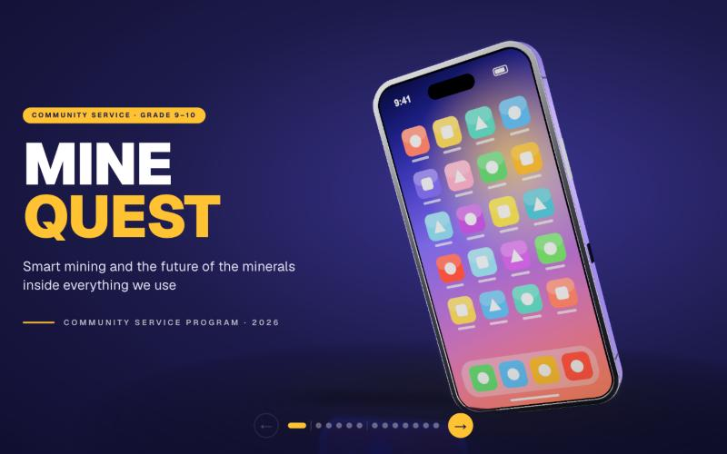
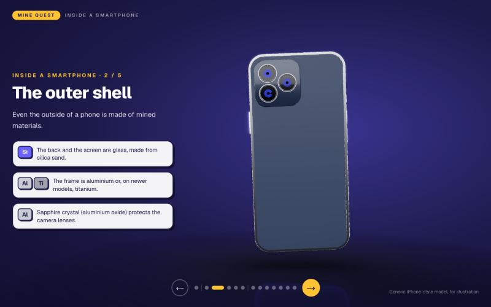

# Mine Quest · Smart mining and the future

**An interactive 3D lesson that shows school students (grades 9–10) where the minerals in their phone come from — and why mining needs to get smarter.**

Built for a 2026 community-service program by Dr. Aboulbaba Eladeb (Chemical Engineering, Northern Border University).

**▶ Live demo:** https://aboulbaba-eladeb.github.io/mine-quest-web/



## What students explore

| Part | What it covers |
|---|---|
| **Mining 101** | What mining is · open-pit vs underground mines · how deep mines go (compared with the Burj Khalifa) · from rock to your charger cable · how much rock it takes for a little metal |
| **Why mining needs an upgrade** | The four steps of a mine — *find, move, crush & sort, make* — and its four big problems: *danger, emissions, water, waste* |
| **What's really inside your phone?** | A 3D smartphone comes apart in five steps — outer shell, parts inside, layer by layer, battery and chip, display and touch glass — and each part is linked to the elements it is made from: silicon, aluminium, titanium, lithium, cobalt, gold, copper, tin, iron, indium, neodymium and carbon |



Every slide is a full-screen 3D scene. Move between slides with **← →** (or Space / the arrows on screen); on the smartphone slides, drag to turn the phone around.

## Built with

- [Next.js](https://nextjs.org) 16 + React 19 + TypeScript
- [three.js](https://threejs.org) via [React Three Fiber](https://r3f.docs.pmnd.rs) and drei, with post-processing
- Tailwind CSS 4
- All 3D models (phone, mine, ore) are built in code — no downloaded assets

## Run it locally

```bash
npm install
npm run dev          # http://localhost:3000
```

### Static build (what GitHub Pages serves)

```bash
PAGES_BASE=/mine-quest-web npm run build   # writes a static site to out/
```

Pushing to `main` rebuilds and publishes the live demo automatically (`.github/workflows/pages.yml`).

## Licence

Code released under the [MIT licence](LICENSE). Teachers are welcome to use the lesson in class.
